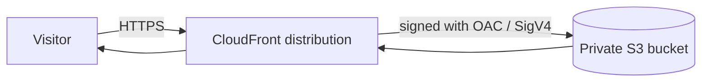
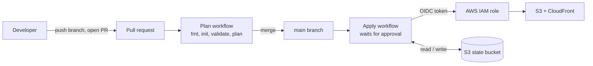

# AWS Static Site with Terraform and GitHub Actions

A static website hosted on S3 behind CloudFront, defined entirely in Terraform and deployed through a GitHub Actions CI/CD pipeline that authenticates to AWS with OIDC (no stored credentials).

Live site: d17jqtlcc2pw7s.cloudfront.net

## What this project demonstrates
- Infrastructure as code with Terraform: S3, CloudFront, Origin Access Control, bucket policies, IAM
- Remote state in S3 with versioning, encryption, and native state locking
- A CI/CD pipeline: plan on pull requests, apply on merge behind a manual approval gate
- Keyless authentication from GitHub Actions to AWS using OIDC and a repo-scoped IAM role
- A least-privilege pipeline role that cannot modify its own permissions

## Architecture

### How vistors reach the site

The bucket blocks all public access. Its bucket policy allows s3:GetObject only to the CloudFront service, and only when the request comes from this specific distribution (AWS:SourceArn condition).

### How changes are deployed

A change is pushed on a branch and a pull request is opened.
The plan workflow runs terraform fmt -check, init, validate, and plan, so the proposed changes are visible in the PR.
After the PR is merged, the apply workflow starts and pauses at the production GitHub Environment until a reviewer approves it.
On approval, the job exchanges a short-lived GitHub OIDC token for temporary AWS credentials and runs terraform apply.

## Security Design
- No AWS keys. The pipline uses OIDC and gets credentials that expire.
- The role's trust policy only accepts toekens whose sub claim matches this repository.
- The piplihne role has read only IAM acess.
- The bucket's public access block is on and the bucket plicy only trusts this CloudFront distribution.

**IAM changes are applied manually by design.** Edits to github_oidc.tf or github_actions_policy.tf must be applied from an administrator login, not by the pipeline.The pipeline's plan will still pass for those files, but its apply would be denied.

## How to deploy your own copy.
1. Create the state bucket. Terraform can't store state in a bucket that doesn't exist yet so this bucket must be created through the CLI or AWS console. Terraform destroy will not delete this bucket or state.

2. In main.tf set the backend "s3" block's bucket to your state bucket. 

3. In variables.tf update state_bucket_name and github_repo to match yours.
bucket_name = "your-globally-unique-site-bucket"
github_repo = "YOUR-GITHUB-USERNAME/YOUR-REPO-NAME"
github_repo_subject uses numeric IDs, in the form OWNER@OWNER_ID/REPO@REPO_ID. GitHub includes these IDs in its OIDC token subject. You can find them in the response from https://api.github.com/repos/OWNER/REPO (the repo id and owner.id fields).

4. The pipeline cannot create its own login role so the first apply is run locally.
Run
aws login
terraform init
terraform plan
terraform apply

Your site URL is on of the outputs.
terraform output cloudfront_domain_name

5. GitHub Actions
In the GitHub repository settings:

Settings > Secrets and variables > Actions > Variables, add:
AWS_ROLE_ARN: the value of terraform output github_actions_role_arn
BUCKET_NAME: your site bucket name
Settings > Environments, create an environment named production and add yourself as a required reviewer. This is the approval gate for the apply workflow.

6. Now you can change the site or infrastructure through pull requests.

## Project next steps

No custom domain. The site uses the default *.cloudfront.net certificate. Adding a domain means requesting an ACM certificate in us-east-1 and a Route 53 or other DNS record.

Security scanning (tflint, checkov or trivy) are not part of the pipeline yet.

A single environment. Separate dev and prod environments can be added.